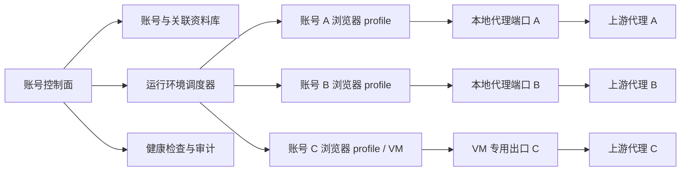

# Muse 多账号隔离开发指引

> 版本：v1.3
> 日期：2026-11-21
> 基座项目：[ldjx7/multi-agent-account-manager](https://github.com/ldjx7/multi-agent-account-manager)
> 目标：在现有“叠号”项目基础上，支持 Windows 优先、Android 后续的多 Muse 账号管理，并逐步增强登录态、网络和设备隔离。

## 1. 结论先行

这个方向可以开发，但必须把目标拆成三类：

| 目标 | 可行性 | 结论 |
| --- | --- | --- |
| 登录态、Cookie、缓存隔离 | 高 | 现有项目已有基础，应继续强化 |
| 每账号网络出口隔离 | 高 | Windows 可实现；Android 需限制为单账号活跃 |
| 浏览器运行环境隔离 | 中 | Windows 可用独立浏览器进程或虚拟机；Android 能力有限 |
| 真实设备隔离 | 中低 | 普通浏览器 profile 不够，必须使用 VM、独立系统用户或独立设备 |
| 账号关系完全隔离 | 低 | 历史邮箱、恢复方式、支付、网络和行为关系无法由客户端彻底消除 |

开发目标是降低误串号和意外网络泄漏，不应把“规避平台识别或封禁”作为验收标准。

## 2. 基座项目现状

叠号是基于 Tauri 2 的跨平台项目，当前主要支持：

- Muse · Meta 与 Hark 的网页登录会话。
- Windows 使用独立 WebView2 数据目录。
- macOS 使用独立 WebKit 数据存储。
- Android 使用 System WebView 的多 profile 能力。
- 账号切换、额度同步、应用内更新和 SHA-256 校验。

相关代码：

- [session_manager.rs](https://github.com/ldjx7/multi-agent-account-manager/blob/main/src-tauri/src/session_manager.rs)
- [platform.rs](https://github.com/ldjx7/multi-agent-account-manager/blob/main/src-tauri/src/platform.rs)
- [storage.rs](https://github.com/ldjx7/multi-agent-account-manager/blob/main/src-tauri/src/storage.rs)
- [providers.rs](https://github.com/ldjx7/multi-agent-account-manager/blob/main/src-tauri/src/providers.rs)
- [Android 会话插件](https://github.com/ldjx7/multi-agent-account-manager/tree/main/src-tauri/plugins/account-session/android)

当前缺口：

1. 没有按账号强制绑定独立网络出口。
2. 没有代理断线后的 fail-closed 防止本机直连。
3. 没有完整展示账号、代理、运行环境和关联资料的映射关系。
4. 普通 WebView profile 不能提供真实硬件或操作系统级设备隔离。
5. Android 的单 App WebView 代理通常无法让多个账号稳定并发使用不同出口。
6. 账号关系治理没有形成可审计的数据模型。

### 当前 Windows 实现进度（Rust 构建和实机验收待完成）

- 账号记录新增可选 `proxyUrl`，旧版账号 JSON 读取时默认为空。
- Windows 界面可为单个账号设置或清除 HTTP / SOCKS5 代理；代理应用到账号 WebView 和 OAuth 登录弹窗。修改后会重建该账号视图。
- 代理 URL 仅接受协议、主机、端口；拒绝路径、查询参数和内嵌认证信息，避免凭据落入账号 JSON。
- macOS / Android 暂不支持 per-account proxy；已有非空代理绑定时阻止启动会话，不静默忽略。
- 切换到绑定代理的账号或预热该账号视图前，以代理服务器为入口执行一次有时限的 HTTP CONNECT 或 SOCKS5 目标连接握手；SOCKS5 把目标域名交给代理解析。DNS 查询、代理 TCP 连接和握手均有超时，检查失败时不创建目标 WebView，切号前置检查失败也保留 Rust 侧当前会话。每次切到绑定代理的账号都会重做检查，包括复用已预热的视图。
- 切换命令失败后，前端重新读取 Rust 会话状态，避免乐观切换把仍然活动的旧账号错误显示为无活动账号。
- 账号列表显示“已配置 · 切号时检查”；这项握手只证明检查当时代理能够建立到服务入口的连接，**不**验证公网出口 IP、国家/地区、ASN、DNS/WebRTC 实际流量路径或 WebView2 断线时的 fail-closed 行为。WebView2 子视图实际逐账号使用独立代理的能力和断代理表现仍须 Windows 实机验收。
- 未绑定代理的账号继续遵循 Windows / WebView2 当前默认网络设置；“未配置独立代理”不能据此认定为物理直连或已实现出口隔离。
- 已有 `npx tsc` 与 `npx vite build --configLoader runner` 的前端验证记录；当前环境未找到 Rust/Cargo 工具链，也未完成本轮变更的 Windows 实机验收。Rust 构建、握手测试和真实代理断连测试应在后续 Windows 验收时完成后再宣称通过。

## 3. 产品范围

### 3.1 第一版必须包含

- 账号列表、登录状态、资料完整度和最后使用时间。
- 每账号独立 profile 标识和独立存储目录。
- 每账号绑定一个代理配置。
- 打开账号前检查代理出口和 DNS。
- 代理不可用时拒绝进入 Muse，不允许静默直连。
- 同一时间只允许一个账号窗口处于活跃操作状态，避免误操作。
- 阻止不同账号共享同一运行目录。
- 账号删除前提供导出、备份和二次确认。

### 3.2 第二阶段增强

- Windows 每账号独立浏览器运行进程。
- 高价值账号启用独立 Windows VM。
- 账号关联资料审计：重复邮箱、恢复方式、代理、设备运行环境等。
- 按账号记录网络健康、异常退出和隔离校验结果。
- 代理绑定漂移检测：账号出口地区或 ASN 与配置不一致时阻止打开。

### 3.3 Android 版本范围

- 支持账号管理和独立 WebView profile。
- 支持单账号按需打开，避免同时预热 10 多个 WebView。
- 支持当前账号的代理/VPN 绑定。
- 多个账号需要不同代理并发时，不使用单 App 模拟；改由不同 Android 用户、Work Profile 或独立设备承担。

### 3.4 明确不承诺

- 不承诺多个账号不会被平台关联。
- 不承诺篡改浏览器指纹后能规避检测。
- 不承诺清除平台上已经存在的关系、风控记录或历史登录环境。
- 不提供规避平台规则、批量注册或绕过验证码的能力。

## 4. 总体架构



架构分为四层：

| 层 | 职责 |
| --- | --- |
| 控制面 | 账号列表、配置、状态、切号、审计、导入导出 |
| 会话层 | 为每个账号创建独立 WebView、Chromium 或 VM 运行环境 |
| 网络层 | 每账号绑定代理、出口检查、DNS 检查、fail-closed |
| 关系层 | 记录账号之间的关系提示，不直接修改第三方账号资料 |

## 5. 核心数据模型

建议把“账号”和“运行环境”解耦：

```text
Account
  id
  provider            muse | hark
  display_name
  login_status
  profile_id
  runtime_id
  proxy_id
  isolation_tier      standard | strict
  last_verified_at
  notes

BrowserProfile
  id
  account_id
  storage_path
  engine              webview2 | webkit | android_webview | chromium
  integrity_hash
  last_used_at

ProxyProfile
  id
  protocol            http | socks5
  endpoint
  expected_country
  expected_asn
  credential_ref
  health_status
  last_check_at

RuntimeProfile
  id
  type                local_profile | chromium_process | windows_vm | android_profile
  profile_id
  proxy_id
  state               cold | starting | ready | blocked

RelationshipWarning
  account_ids
  warning_type        shared_proxy | shared_profile | shared_recovery | user_marked
  severity
  message
```

约束：

- `Account.id`、`BrowserProfile.id`、`ProxyProfile.id` 必须稳定，不随显示名变化。
- profile 路径不能由前端传入，防止路径穿越或误用其他账号目录。
- 代理密码使用 Windows DPAPI 或 Android Keystore 保存，不写入普通 JSON。
- 每个账号只有一个当前主 profile；迁移 profile 必须显式执行。
- 运行环境不可用时显示“阻断”，不能自动退回共享环境。

## 6. Windows 隔离设计

### 6.1 推荐分级

| 等级 | 方案 | 隔离强度 | 成本 |
| --- | --- | --- | --- |
| L1 | 独立 WebView2 UserDataFolder | 存储隔离 | 低 |
| L2 | 独立 WebView2 + 独立代理端口 | 存储和网络隔离 | 中 |
| L3 | 独立 Chromium 进程 + 独立 profile + 代理 | 进程、存储和网络隔离 | 中高 |
| L4 | 每账号独立 Windows VM | 接近设备隔离 | 高 |

第一版建议做到 L2，高价值账号按需使用 L3 或 L4。

### 6.2 会话隔离

- 每个账号使用固定 profile 目录。
- 包内只保存 profile 映射，不把账号资料复制进共享目录。
- 启动后读取 WebView2 实际 `UserDataFolder`，与期望路径核对；不一致立即终止。
- 同一 profile 加进程锁，禁止两个窗口同时写入。
- 账号退出时清理临时下载和临时文件，不清理登录态。

### 6.3 网络隔离

当前 Windows 版本支持每个账号配置 HTTP / SOCKS5 endpoint，并将配置应用到对应 WebView 和登录弹窗；修改绑定后会重建该账号会话。打开或预热绑定代理的账号前会做有时限的 CONNECT / SOCKS5 握手，切号前再次检查。此项属于代理可用性预检，不等于对浏览器实际出口的完整检测或强制网络隔离。代理断线时是否可能直连、WebView2 子视图间代理是否完全独立、DNS / WebRTC 是否沿预期出口，均待 Windows 真机验证。

首选技术验证：

1. 为每个账号分配一个仅监听 `127.0.0.1` 的本地代理端口。
2. WebView/Chromium 使用独立环境启动，并强制指定该端口。
3. 本地代理再连接该账号对应的上游 HTTP/SOCKS5 代理。
4. 本地代理拒绝 `DIRECT`；上游不可用时返回明确错误。
5. 打开 Muse 前先执行出口检查，确认公网 IP、国家/地区、ASN。
6. 页面打开后持续检测代理健康；关键请求失败时停止继续操作并提示阻塞。

技术预研项：

- 验证当前 Tauri/Wry 版本是否支持为不同子 WebView 指定独立的 WebView2 启动参数和代理环境。
- 如果不支持，将浏览器运行层拆成独立 Chromium runner，由 Tauri 管理窗口和账号数据。
- 不允许依赖系统全局代理作为唯一隔离手段。

### 6.4 设备隔离

普通 profile 只能隔离浏览器数据，不能隔离：

- 操作系统版本和硬件信息。
- GPU、字体、屏幕参数和系统区域设置。
- 网络适配器和本机时区。
- 平台通过行为模式形成的关联。

需要更强隔离时：

- 高价值账号使用 Hyper-V VM，每个 VM 固定账号、代理和 profile。
- 中低价值账号使用独立浏览器进程，不共享 cookie 和缓存。
- 不建议仅靠随机化浏览器参数冒充新设备；配置不稳定反而增加登录异常。

## 7. Android 隔离设计

Android 版建议定位为“便携控制端”，不做 10 多个账号的强隔离宿主。

| 能力 | 设计 |
| --- | --- |
| 账号存储 | 每账号独立 `dataDirectorySuffix` 或等价 profile |
| 活跃实例 | 默认只保留当前一个活跃 WebView |
| 网络 | 为当前账号绑定代理/VPN，切换账号时重新检查出口 |
| 后台 | 不预热全部账号，减少内存和耗电 |
| 并发 | 需要同时不同代理时，使用不同 Android 用户空间、Work Profile 或独立设备 |
| 设备隔离 | 单 App 无法提供真实硬件隔离 |

Android 验收要求：

- 确认目标设备的 System WebView 支持多 profile。
- 不支持时降级为单账号独立存储，不伪装成已隔离。
- 切换账号前关闭旧 WebView，并确认网络出口已切换。
- 代理变化或 VPN 断开时阻止继续发起 Muse 请求。

## 8. 账号关系治理

账号关系不是单纯的浏览器目录问题。开发层面只能做记录、提醒和隔离，不能替代账号自身的历史与资料治理。

建议提供以下检查：

- 同一代理 endpoint 是否分配给多个账号。
- 同一出口 IP、国家或 ASN 是否异常集中。
- 同一 profile 路径或 runtime 是否被多个账号引用。
- 用户是否标注两个账号共用恢复方式、连接器或业务资料。
- 账号最近一次环境变化是否过大，例如国家、设备类型或运行环境突变。

检查结果只作为提示和阻断依据，不应自动修改账号资料。

## 9. 开发阶段

### P0：基座审计

- 固定上游 commit，建立本地 fork。
- 运行 Windows 和 Android 构建。
- 记录当前 profile 创建、删除、切换和异常恢复流程。
- 为账号存储迁移建立测试样本。

完成标准：

- Windows 可构建并启动。
- Android 可在至少一台真机或标准模拟器上启动。
- 能明确看到每个账号使用的数据目录。

### P1：隔离状态可视化和数据模型

- 增加 `BrowserProfile`、`ProxyProfile`、`RuntimeProfile`。
- 增加账号与运行环境的一对一校验。
- 增加“未绑定代理”“目录不一致”“环境被阻断”等状态。

已接入首轮：

- `proxyUrl` 可选字段兼容旧数据。
- Windows 账号卡片可见代理配置状态，并能编辑每账号 HTTP / SOCKS5 endpoint。
- WebView 和登录弹窗使用对应账号的代理设置；设置变更会销毁并重建已有账号视图。
- 非 Windows 平台对已绑定代理的账号 fail closed，避免忽略该配置后照常打开。

尚未完成的验收：

- 任意账号都能看到其 profile、代理和运行环境。
- 发现配置冲突时阻止账号打开。

### P2：Windows 网络隔离与 fail-closed

- 实现按账号本地代理端口。
- 实现上游代理健康检查和 fail-closed。
- 实现出口 IP、国家/地区、ASN 预检。
- 完成不同 WebView 独立代理的技术验证。
- 验证代理掉线期间请求不会绕过代理；若 WebView2 不提供可证明的禁止直连保证，应由仅转发上游且拒绝 `DIRECT` 的本地代理承载流量。

完成标准：

- 账号 A 和账号 B 使用不同代理打开 Muse。
- 停掉账号 A 的代理后，账号 A 无法直连，账号 B 不受影响。
- 重启应用后绑定关系保持不变。

### P3：Windows 强隔离

- 高价值账号支持 Chromium runner。
- 提供可选 Windows VM 运行方式。
- 记录 VM、profile、代理三者绑定关系。

完成标准：

- VM 运行失败时不会降级到宿主机 WebView。
- 解除或迁移绑定需要显式确认并留审计记录。

### P4：Android 按需模式

- 复用账号与代理数据模型。
- 实现单账号活跃 WebView。
- 实现网络切换检查和旧会话关闭。
- 验证不同厂商 System WebView 的兼容性。

完成标准：

- 两个账号来回切换时，登录态保持且无 Cookie 串用。
- 代理断开时页面停止继续操作。
- App 被系统回收后能恢复到正确的账号和 profile。

### P5：运维与迁移

- 账号导入导出。
- profile 和代理配置备份。
- 版本升级后的配置迁移。
- 诊断日志与脱敏导出。
- 卸载和回滚流程。

## 10. 测试计划

### 10.1 功能测试

- 新增、重命名、切换、删除账号。
- 每个账号登录后重启应用，登录态仍绑定原 profile。
- 代理变更后必须重新验证出口。
- 分别验证 HTTP / SOCKS5 设置、错误 endpoint、代理掉线及恢复；禁止用“配置已保存”冒充“隔离通过”。
- WebView 崩溃、进程回收和异常退出后的恢复。

### 10.2 隔离测试

| 测试 | 方法 | 预期 |
| --- | --- | --- |
| Cookie 串用 | A、B 同时登录不同账号 | A 的请求不会出现 B 的身份信息 |
| 目录串用 | 将两个账号指向同一路径 | 系统阻止保存并报警 |
| 代理串用 | A、B 绑定不同端口 | 流量分别命中对应出口 |
| 代理断开 | 停止 A 的上游代理 | A fail-closed，不直连 |
| 出口漂移 | 模拟出口国家或 ASN 改变 | 阻断并要求重新确认 |
| 重启恢复 | 重启电脑/App | profile、代理映射和阻断状态保持 |
| Android 回收 | 后台杀掉 App | 重新打开只恢复对应账号，不合并 Session |

### 10.3 规模测试

- 先使用 2 个账号验证隔离正确性。
- 再使用 5 个账号验证切换和资源占用。
- 最后扩展到 10 多个账号，但只保留当前账号活跃。
- 记录每个账号启动时间、内存峰值、代理检查成功率和异常次数。

## 11. 安全与运维要求

- 代理密码不得明文写入日志、截图或导出文件。
- 日志按账号区分，但邮箱、token、cookie、代理账号要脱敏。
- 导入配置时验证 schema 和 profile 路径。
- 删除账号必须二次确认，并提供可恢复的导出备份。
- 更新包继续验证 HTTPS、允许域名和 SHA-256。
- 运行中不使用全局代理或共享默认 profile 作为兜底。
- 不执行来源不明的自动登录、批量重置或验证码绕过脚本。

## 12. 推荐目录拆分

```text
src-tauri/
  src/
    accounts/
      model.rs
      repository.rs
      relationship.rs
    profiles/
      model.rs
      manager.rs
      integrity.rs
    network/
      proxy_profile.rs
      local_supervisor.rs
      egress_check.rs
    runtime/
      mod.rs
      webview2.rs
      chromium.rs
      android.rs
      windows_vm.rs
    audit/
      event_log.rs
      redaction.rs
```

保持账号、profile、代理和 runtime 的职责分离，避免把网络或路径判断散落到 UI 层。

## 13. 风险清单

| 风险 | 影响 | 处理 |
| --- | --- | --- |
| WebView2 不支持独立代理参数 | 无法在单进程内完成网络隔离 | 预研 Chromium runner 或独立进程 |
| 代理静默回落直连 | 环境泄漏 | 只允许指定代理，检测失败即阻断 |
| Android WebView 代理全局生效 | 多账号并发出口混乱 | 限制单账号活跃或拆分设备/用户空间 |
| profile 被误删 | 登录态丢失 | 原子写入、备份和二次确认 |
| 系统回收后台 WebView | 切换后状态异常 | 状态机恢复和冷启动 |
| 依赖 Muse 内部接口 | 网站更新后额度功能失效 | 隔离非核心功能，失败不影响基础登录 |
| 账号历史关系已存在 | 无法通过客户端解除 | 明确产品边界，只提供提示和审计 |

## 14. 开工顺序

1. Fork 当前仓库并固定版本。
2. 做两个账号的独立 profile 基线测试。
3. 验证 Windows 每账号独立代理的可行性。
4. 实现 fail-closed 和出口检查。
5. 增加账号、profile、代理三者绑定界面。
6. 通过隔离测试后再接入 10 多个账号。
7. 最后开发 Android 按需模式。

## 15. 第一轮交付物

第一轮不直接改 10 多个账号的生产数据，先交付：

- Windows fork 的可运行版本。
- 每账号代理配置和健康检查。
- 两账号隔离测试报告。
- 代理断开不直连的证明。
- 账号/profile/代理数据模型。
- 已知限制和迁移方案。

验收通过后，再决定是继续扩展 WebView2，还是将浏览器运行层升级为独立 Chromium 进程。
