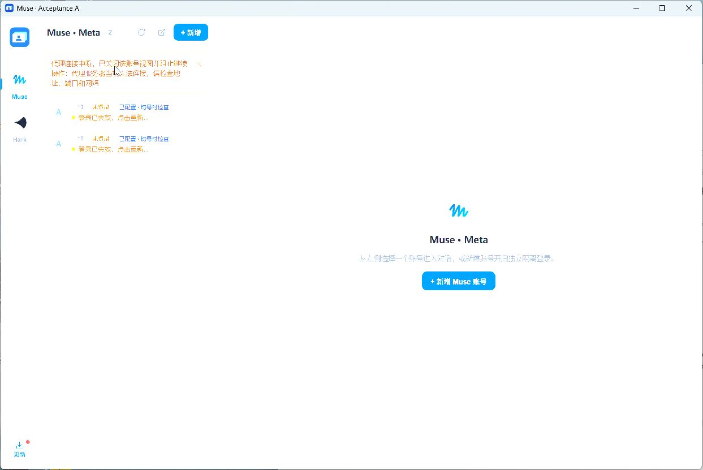
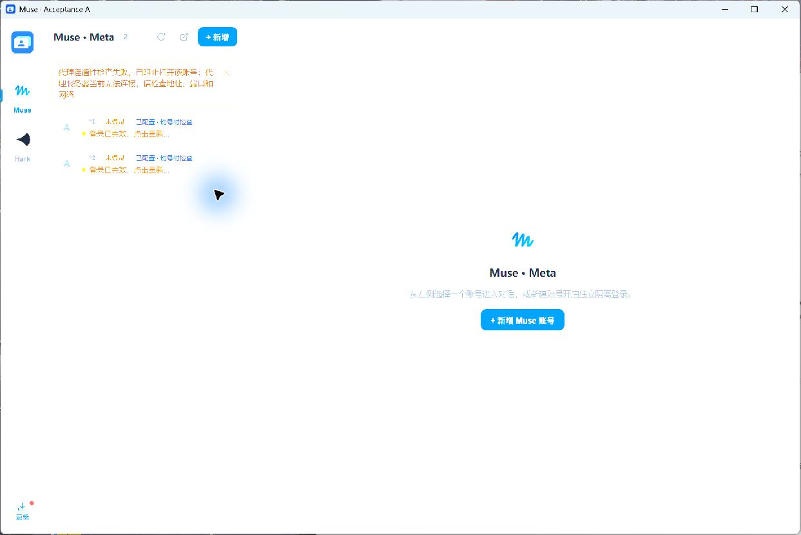
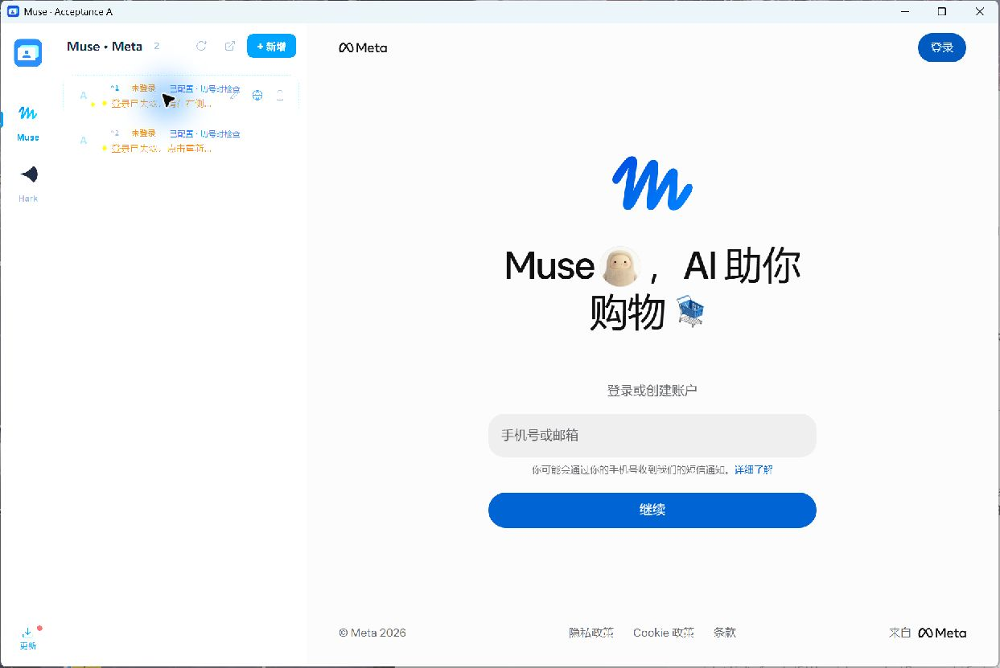
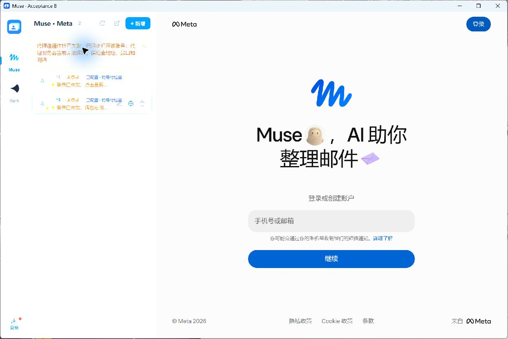
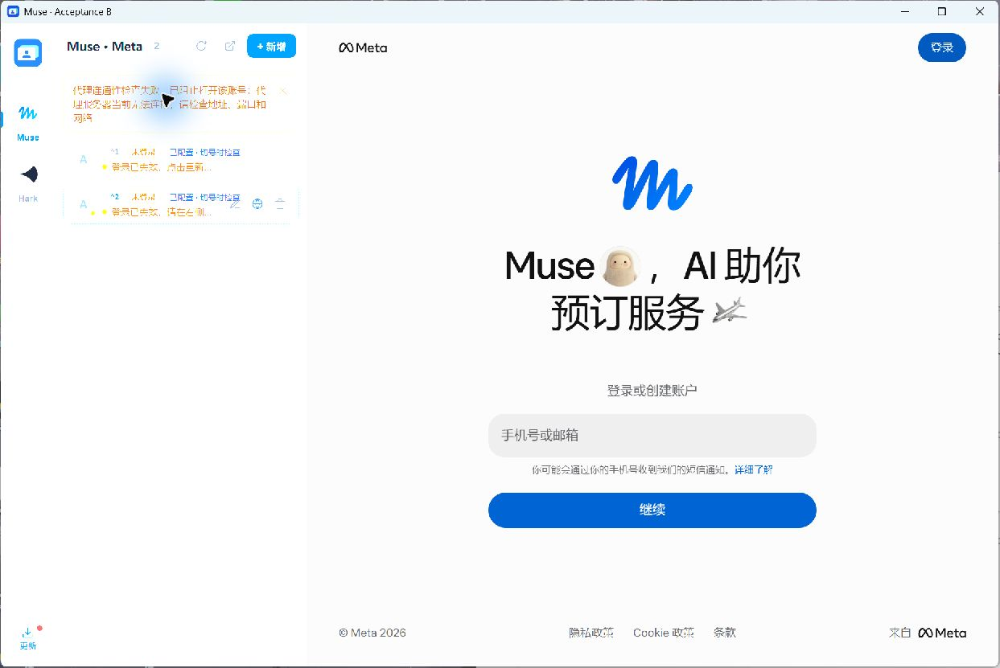

# Windows 代理断线实机验收记录：2026-11-21

结论：在两个**未登录的合成测试 profile**、两条独立本地 HTTP CONNECT 代理的场景下，观察到了代理停止后关闭对应账号视图、阻止重开、恢复代理后重新加载、另一 profile 保持前台，以及应用重启后继续阻止不可用代理的行为。Windows Rust 单测 13/13 通过。

这份记录只证明下列具体应用层行为。未使用生产账号登录，也未验证公网出口、DNS/WebRTC、真实设备指纹、历史账号关系或系统防火墙级 fail-closed。不能据此把 10 多个生产账号的隔离状态标为已验收。

## 版本与环境

| 项目 | 实际值 |
| --- | --- |
| 测试提交 | `86679ef6b77a0602bbb20b0d55d1d4a7769994b1` |
| Windows | x64，25H2，OS build `26200.9974` |
| WebView2 | `157.0.4341.60` |
| 程序 | `0.1.5`，本分支 CI 构建的独立 EXE |
| CI | [Windows validation 44905317563](https://github.com/dngding/multi-agent-account-manager/actions/runs/44905317563) |
| Artifact | `windows-x64-nsis-acceptance`，ID `14708006444` |
| Artifact ZIP SHA-256 | `50538c7868190dd1af738b8c0ba84bbe51d9d25dcae7662362320d223334f746` |
| EXE SHA-256 | `10892aee8da9730683dbc58f14cc0c96390e879a3b2c3fb998fede5442811440` |
| NSIS SHA-256 | `947de80d64204dbce21f1d011feaf2f5a7fc08fc89e1960c96dc3188d9e27cfe` |

本机没有 Rust/Cargo/MSVC。CI 在 Windows 2025 runner 上运行锁定依赖的 Windows Rust 测试、前端构建、变更 Rust 格式检查、NSIS 和独立 EXE 构建，全部成功。Rust 日志原文：

```text
running 13 tests
test app_paths::tests::explicit_data_directory_does_not_use_default_store ... ok
test app_paths::tests::invalid_override_fails_instead_of_falling_back ... ok
test network::tests::rejects_proxy_that_disconnects_during_http_tunnel ... ok
test result: ok. 13 passed; 0 failed; 0 ignored; 0 measured; 0 filtered out
```

## 数据准备和目录证据

- 使用全新 `DIEHAO_DATA_DIR`，未复制生产账号库或登录资料。预置 `Acceptance A/B` 两个合成别名，`lastCommitted=null`，分别绑定 `http://127.0.0.1:64846/` 和 `http://127.0.0.1:64847/`。
- A UUID 为 `11111111-1111-4111-8111-111111111111`；B UUID 为 `22222222-2222-4222-8222-222222222222`，均为合成值。
- 进程树核对实际 WebView2 `--user-data-dir`：管理页在测试根的 `manager-webview/EBWebView`；账号分别在 `profiles/<A或B UUID>/EBWebView`。
- A/B 的 WebView2 主进程分别带 `--proxy-server=http://127.0.0.1:64846` 和 `--proxy-server=http://127.0.0.1:64847`。本地 TCP 连接也实际命中各自代理监听端口。这些参数和连接证据不等同于公网出口泄漏检测。
- 先分别打开 A/B，均显示 Muse · Meta 公开登录页。未向页面输入邮箱、密码、OTP、Cookie 或 token，也未提交登录操作。

## 故障注入结果

时间均为北京时间（UTC+8）。

| 操作 | 现场结果 | 判定 |
| --- | --- | --- |
| A 前台，21:04:47.704 停 A 代理 PID 26036 | 21:05:02.724 检查时，A WebView2 主进程已消失，管理页和 B 的主进程仍在 | 通过本次本地监听停止场景 |
| 读取 A 断线后的窗口 | 页面回到管理页，显示“代理连接中断，已关闭该账号视图并阻止继续操作” | 通过 |
| A 代理仍停，再点 A | 提示代理握手失败、已阻止打开；检查时无 A 主进程 | 通过 |
| 打开 B | B 公开登录页继续显示，B 仍使用自己的目录和代理 | 通过公开页面观察 |
| 21:08:19.585 恢复 A 代理，PID 22392 | 再点 A 后新建视图，Muse 公开登录页重新加载 | 通过 |
| 切 B 前台，21:10:36.214 停后台 A 代理 | 21:10:51.382 检查时 A 主进程消失，B 主进程 PID 5824 保留，B 页面持续显示 | 通过 |
| 再点已失效的后台 A | A 预检失败，B 页面保持前台；未切到空白 A 页面 | 通过 |
| A 仍停，21:15:01 重启应用 | B 自动恢复，实际主进程仍使用 B 的目录与代理；A 未创建 | 通过 |
| 重启后再点 A | 再次提示握手失败、阻止打开，B 继续在前台显示 | 通过 |

两次停止本地代理后的进程检查均发生于停止约 15 秒后。没有采样到精确关闭瞬间，因此不报告精确响应延迟；DNS/TCP/握手黑洞的超时也不在此次覆盖中。

## 截图证据

以下截图只含合成 profile 和未登录公开页。

代理停止后关闭 A 并提示：



代理未恢复时阻止 A 重开：



恢复代理后 A 页面重新加载：



A 预检失败，B 保持前台：



重启后继续阻止 A，B 仍保持前台：



## 清理与待办

21:17:48 完成清理：测试应用已退出，两条测试代理均停止，临时 WebView2 profile 数据已删除。生产配置的前后哈希以及默认项目目录存在状态一致；未把账号配置、Cookie、密钥或原始进程命令行上传仓库。保留的是合成别名截图、版本、测试结果和本地脱敏记录。

后续独立验收：

- 已登录测试账号的会话持续性和实际操作、登录弹窗继承的现场验证。
- HTTP 以外的 SOCKS5 实机故障注入和代理黑洞超时。
- 公网出口 IP/国家/ASN 与 DNS、WebRTC 泄漏测试。
- 系统层拒绝直连的 fail-closed，以及 5/10 多 profile 的资源与并发测试。
- UI 新增账号时先要求代理再打开；当前入口先无代理打开，生产导入前需处理。
- 后台 profile 断线关闭后立即刷新 UI 的预热标记；当前不立即发新 snapshot，标记可能暂时陈旧，但重开仍执行代理预检。

复现步骤见 [Windows 代理断线验收手册](windows-proxy-disconnect-acceptance.md)。
