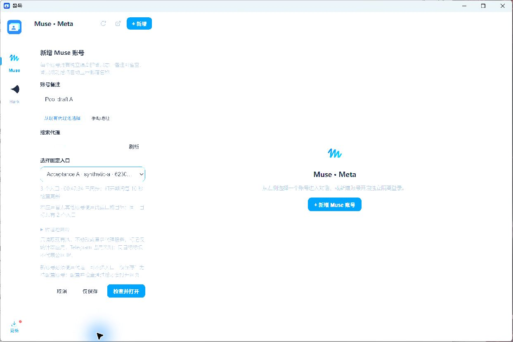
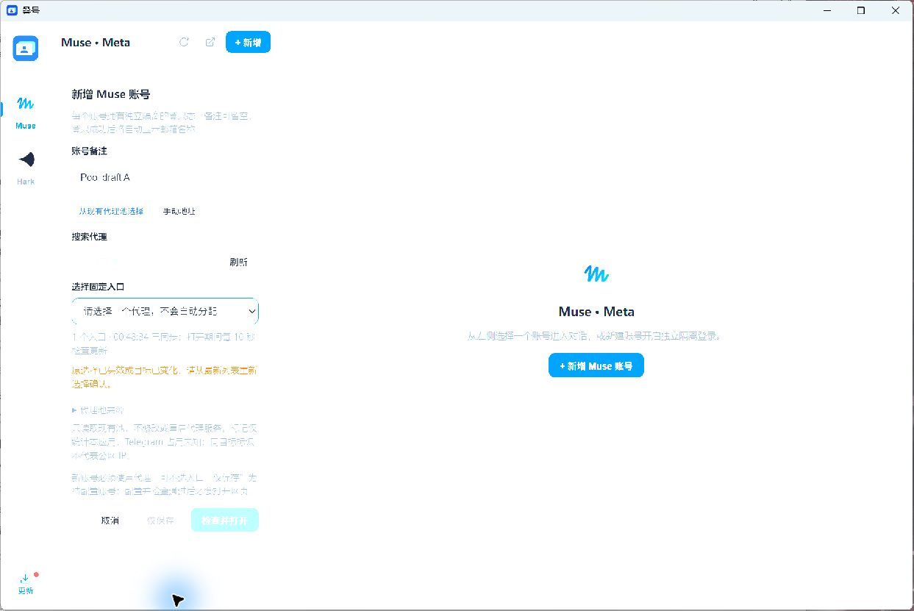
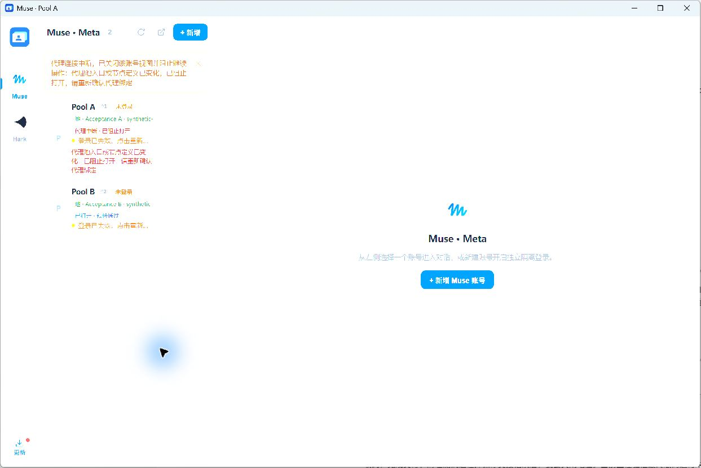
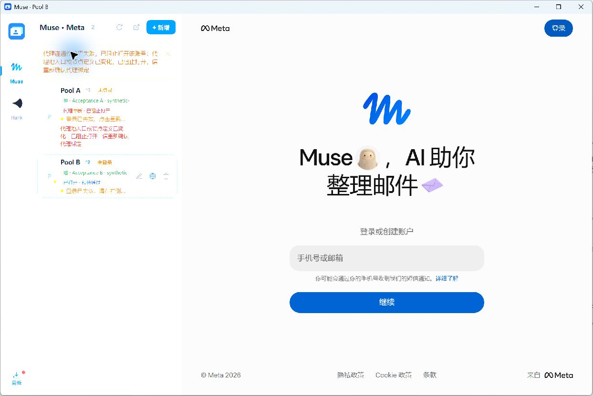

# Windows 现有代理池选择器验收记录

> 日期：2026-11-22，北京时间 UTC+8
>
> 状态：Windows CI、限定合成场景实测及清理已完成。候选列表场景归属 `a4ac022`，最终 `01c596d` 另完成保存绑定、运行中定义漂移关闭及重开阻断；没有在最终构建重跑全部候选场景。

现有代理池选择器已取得两组直接证据：`a4ac022` 的候选新增、删除、坏 YAML 和定义变化处理；最终 `01c596d` 的池绑定保存、待激活保护、A 定义变化后关闭并阻止重开、B 原进程与公开页面保留。最终 Windows CI 的 Rust 结果为 **42 passed / 0 failed**，前端、独立 EXE 与 NSIS 构建成功。

本轮使用空白测试目录、合成本地池和未登录 profile，验证文件与账号绑定的一致性及有限应用层阻断。未使用生产代理池作为应用来源，未输入登录凭据，未执行 Telegram 登录、认证或账号操作。列表变化不证明运行中的 Mihomo 已重载、浏览器公网出口独立，或 Telegram 未使用该目标。

## 版本与构建

| 项目 | 核实结果 |
| --- | --- |
| 候选列表实测源码 | `a4ac02299feb16c60de1466fcbbc8745b27ee373` |
| 候选版本 CI | [Windows validation 44924757230](https://github.com/dngding/multi-agent-account-manager/actions/runs/44924757230)，Rust 42/42 |
| 最终源码 | `01c596ddffed9f7e579b82d1b7eda498654e2929` |
| 最终 CI | [Windows validation 44926476039](https://github.com/dngding/multi-agent-account-manager/actions/runs/44926476039)，全部成功 |
| 最终 artifact | [windows-x64-nsis-acceptance，14715672060](https://github.com/dngding/multi-agent-account-manager/actions/runs/44926476039/artifacts/14715672060)，包含独立 EXE 和 NSIS |
| 程序版本 | `0.1.5` 功能分支验收构建，以源码 SHA 区分 |
| 实机环境 | 本机 Windows / WebView2；本报告未单独重新记录其精确版本，不沿用旧报告数值 |

最终文件 SHA-256：

| 文件 | SHA-256 |
| --- | --- |
| artifact ZIP（下载后已核对） | `f4b916aabee4893695a619f946ccb1018f9928b27c4bcf6d3557792c8d750be1` |
| 独立 EXE | `f7017fe5a6ae2874ce0b2f0eafa71bae05f486983598833d5ae7b1be267f32a2` |
| NSIS 安装器 | `068ebf17ec45e6855fbbb9e115b2d2744a553a1b1f30a2257a1d1db664044413` |

已回读最终 CI 日志：

```text
running 42 tests
test result: ok. 42 passed; 0 failed; 0 ignored; 0 measured; 0 filtered out; finished in 0.05s
```

最终日志无 Rust 格式 `Diff` 或编译 warning。单测和构建通过不代替 UI、WebView2 或实际流量路径验收。旧候选版本 artifact 为 `14715382799`，其 CI 上传 ZIP 摘要为 `0ee59804930367e83415dd238036665254b79d9dcd1d9246fd74e4bc431fbc08`；交付使用上述最终构建。

## 隔离测试准备

- 全新 `DIEHAO_DATA_DIR` 从空账号库启动，没有复制生产登录资料。
- `DIEHAO_PROXY_POOL_FILE` 显式指定合成 `synthetic-sidecar.yaml`，测试不自动发现生产来源。
- A 使用 `http://127.0.0.1:62302/`，B 使用 `http://127.0.0.1:62303/`。初始 YAML 的两条 HTTP listener 分别引用两个静态 `ss` 合成节点定义。
- 合成 `ss` 节点只供解析和定义比较，未运行 Mihomo，也未连接合成远端。实际入口由独立测试 helper 提供。
- A 为 `stall` 模式：CONNECT 返回 200 后不完成 TLS，不连接远端。B 为普通 CONNECT 转发模式。
- C 使用 `62304` 并指向 A 的同一合成目标；没有启动 C 转发服务，仅测试候选变化与重复目标提示。
- 原始配置、事件与进程记录留在仓库外 `_acceptance/scoped-webview2-20261122-003843/`；UI 原始记录位于 `_acceptance/pool-evidence-a4ac022/`。该目录名是证据归档名称，其中 05/06/07 实际来自最终 `01c596d` 构建。

## 候选列表实测：`a4ac022`

| 场景 | 时间与直接证据 | 判定 |
| --- | --- | --- |
| 新增候选 C | 00:46:30.472914 注入 `add`；UI 同步文本为 00:47:34，显示 3 个入口、已选 A、“同目标 2 入口”，备注仍为 `Pool draft A` | 候选新增、原选择和备注保留、重复目标提示通过 |
| 删除已选 A | 00:47:59.653667 注入 `remove-a`；UI 同步文本为 00:48:34，剩 1 个入口，选择回到占位项并提示失效，两种提交按钮禁用，备注保留 | 删除后清选择和禁提交通过，没有自动选择 B |
| 坏 YAML | 00:48:59.945930 注入 `invalid`；UI 树 03 显示 YAML 错误、候选控件禁用、原选择失效及两种提交按钮禁用 | 解析失败后不接受旧选择通过 |
| 同端口目标定义变化 | UI 树 04 显示恢复为 2 个候选，原选择失效，保持占位项、备注保留且提交禁用 | 不静默沿用旧定义、恢复后要求重新选择通过 |

时间来自 helper `events.log` 和 UI 同步文本。截图落盘时间不作为精确响应时间；本轮没有分别量测 10 秒轮询、恢复焦点和手动刷新各自的延迟或触发归属，也没有将焦点保持标作实机通过。





## 最终构建实测：`01c596d`

| 场景 | 直接观察 | 判定 |
| --- | --- | --- |
| 从池“仅保存” A | 保存 endpoint 与 `sourcePath / entryId / fingerprint / label` 四字段绑定；`pendingActivation=true`，未创建 profile 或浏览器进程 | 池绑定保存与待激活保护通过 |
| B 检查并打开 | 创建 WebView2 浏览器 PID `28460`，使用 B 的 `62303` 代理 | 本次 B 独立绑定与打开通过；不证明公网出口独立 |
| 手动打开 A | 创建 PID `27540`，使用 A 的 `62302` stall 入口；UI 树 05 已显示 `ERR_TIMED_OUT` | 已建 A 视图；不能据此声称首次始终未完成加载的窗口已被覆盖 |
| A 定义变化后的运行复核 | `change-a` 后 01:29:27 查询，A 浏览器进程为 0，B 原 PID `28460` 保留；UI 树 06 显示 A“代理中断 · 已阻止打开” | 运行中绑定漂移关闭 A 并保留 B 通过 |
| 切回 B 后重开 A | B 公开 Muse 登录页可见；再次点 A 被原绑定预检阻止，UI 树 07 显示错误，B 仍保留 | 重开阻断及 B 保留通过 |





此处只确认配置定义变化触发的应用层处理。A 使用 stall 入口时，实际取证已到超时错误页，因此“首次导航始终没有 Finished 事件时仍回收视图”仍是未覆盖项。最终构建没有重跑上一节全部候选列表场景。

## 清理与生产状态核对

01:34:45 退出本轮测试 EXE 和两条测试代理。核对测试监听为 0；最初剩余的 2 个 scoped WebView2 进程自行退出后，再次查询为 0。随后删除本轮测试 data，将活动状态文件归档为 run 目录中的 `completed-state`，保留合成证据。

生产配置快照前后一致。现有 sidecar 配置只读摘要为 `65aa1f280334c01dba17c9b59f786f3522c1230594407e5e006cc6c198d8c632`；没有改写或重启生产代理。`GameViewerService` 现场仍为 Running，未操作远控服务。未覆盖当前安装程序，未修改系统代理、TUN 或防火墙。此处只记录测试清理，不包含关机结果。

## 尚未覆盖的场景与边界

| 项目 | 当前边界 |
| --- | --- |
| 刷新路径与来源 UI | 10 秒、恢复焦点、手动刷新尚未分项实测；单 / 多来源自动发现与切换 UI 未完成独立实测 |
| 保存时竞态 | 后端重读由源码与单测支撑，尚未在 UI 中精确注入“列表刷新后、提交前”变化 |
| 手动解绑与重启 | 本轮未实测手动保存清绑定、来源切换后的其他账号持久化或重启恢复 |
| 初次持续加载 | A 取证已到 `ERR_TIMED_OUT`，没有覆盖首次始终不触发 Finished 的窗口 |
| 真实服务和生产账号 | 未用真实生产池 / 机场链路，没有验证 Mihomo 热重载、生产登录、完整 OAuth、SOCKS5 实机或 10 多账号规模 |
| 网络与关系隔离 | 未验证浏览器公网 IP / ASN、DNS / WebRTC / IPv6 / UDP、系统级拒绝直连、设备或历史账号关系隔离 |
| Telegram 占用 | 未访问 Panel 账号 API、数据库或会话；占用提示只统计本应用，不能判断 TG 空闲 |

使用方式见[现有代理池配置说明](existing-proxy-pool-setup.md)。此前新增账号与后台状态基线见[2026-11-21 状态报告](windows-proxy-setup-state-acceptance-2026-11-21.md)，其版本与范围保持独立。
